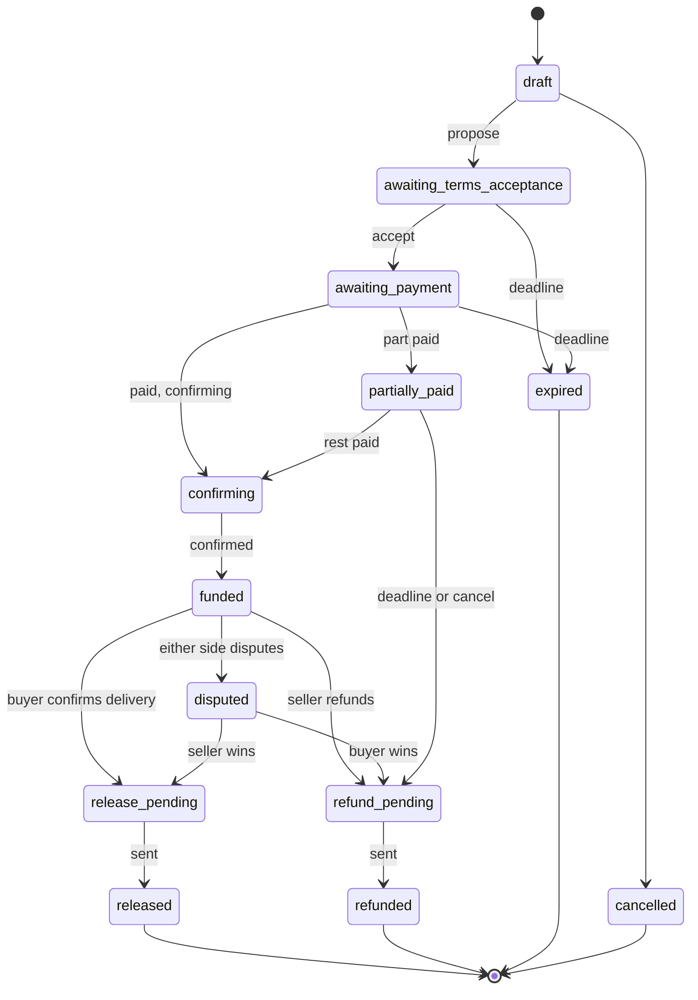
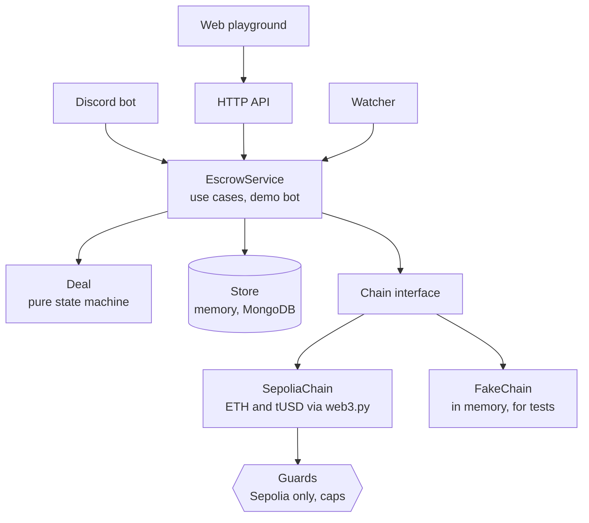

# Holdfast

**A crypto escrow engine: two strangers trade, and neither has to trust the other.**

[](https://github.com/danibapsilva/holdfast/actions/workflows/ci.yml)


[](LICENSE)

> [!WARNING]
> **Test networks only.** Holdfast runs on Ethereum's Sepolia test network with a test dollar (tUSD) that
> has no value. It refuses to start on any other network. This is a portfolio project, not a service.

The buyer pays into an address that belongs to that deal alone. Holdfast watches the chain until the
payment is confirmed, then sends the money to the seller when the buyer confirms delivery, or back to the
buyer on a refund. If they disagree, an arbiter decides, or a timer settles it by a written rule.

I run an escrow system like this privately; it has secured over $1M across more than 10,000 users. That
code stays private. Holdfast is written from scratch to show how the engine works, with the parts that make
it a business (mainnet networks, fees and payouts, fraud rules) deliberately left out.

## A trade, start to finish

`python examples/demo_trade.py` runs one on an in-memory chain:

```text
Alice sells a design to the demo bot for 25 tUSD.

  The demo bot accepts and pays the deposit    awaiting_payment   received 0 tUSD
  The watcher sees the payment (1 block)       confirming         received 25 tUSD
  One more block: confirmed, so funded         funded             received 25 tUSD
  Alice delivers; holdfast-demo releases       released           received 25 tUSD

Alice was paid 24.75 tUSD (the demo's 1% fee stays put).
```

## Design decisions

These are the choices that make an escrow trustworthy, and where each one lives.

| Decision | Why | Where |
| --- | --- | --- |
| **The deal is a pure state machine.** A table says which role may take which action in which state; everything else is refused with a plain error. Time is passed in, never read. | The rules of the money can be tested exhaustively (every action in every state, about 940 cases) without a network, a database, or a clock. | [`deal.py`](src/holdfast/deal.py) |
| **Money is an integer.** Amounts are counts of a token's smallest unit; user text is parsed with `Decimal` once, at the edge. | Floats lose cents. An escrow can't. | [`money.py`](src/holdfast/money.py) |
| **Every transfer is credited once, ever.** Payments are keyed by transaction hash and log index, and a global claim ties each one to a single deal. | The same transfer seen again (a restart, a reorg, a second watcher) can't fund a deal twice or fund two deals. | [`store.py`](src/holdfast/store.py), [`service.py`](src/holdfast/service.py) |
| **A payout is written down before money moves.** If a send fails midway, the deal is flagged for a person instead of retried. | A blind retry after a crash is how escrows pay twice. | [`service.py`](src/holdfast/service.py) `settle` |
| **One seed, no key files.** Each deal's deposit address is derived from one secret (BIP-44, address index = deal number). | Nothing sensitive sits on disk, and every deal's funds are isolated at their own address. | [`chains/hd.py`](src/holdfast/chains/hd.py) |
| **It fails closed on real money.** The network is checked at startup and before every send; the token contract refuses to deploy off Sepolia; CI fails if a mainnet address appears in the code. Deals and daily sending are capped. | A wrong RPC URL should stop the program, not move funds. | [`guards.py`](src/holdfast/guards.py), [`TestUSD.sol`](contracts/TestUSD.sol) |
| **Rules are frozen into each deal.** Confirmations, the payment window, and the dispute timer are copied onto the deal when it's made. | Changing a setting never changes the terms of a trade already in progress. | [`deal.py`](src/holdfast/deal.py) |
| **Networks sit behind one interface.** The engine only knows `Chain`; Sepolia and an in-memory chain both implement it. | Tests run a whole trade in milliseconds, and another network is one more class. | [`chains/`](src/holdfast/chains/) |

## How a deal moves



The dispute timer's rule: if the other side never answers, whoever opened the dispute wins; if both sides
engaged, the buyer is refunded, because returning money to whoever paid it can't strand anyone's funds.

## Architecture



Every caller (the API, the bot, the watcher) goes through `EscrowService`, which loads a deal, applies one
action as the caller's role in it, and saves it with optimistic locking. Only `settle` moves money. More in
[docs/architecture.md](docs/architecture.md).

## Using the engine

```python
from holdfast import EscrowService, MemoryStore, Role, parse_amount, tusd
from holdfast.chains.fake import FakeChain
from holdfast.guards import Caps

token = tusd("0x...")  # the deployed tUSD contract
service = EscrowService(MemoryStore(), FakeChain(), token, caps=Caps(per_deal=10**8, per_day=10**9))

deal = service.create_deal(
    creator="alice",
    creator_role=Role.SELLER,
    counterparty="bob",
    amount=parse_amount("25", token),
    description="A logo",
)
deal = service.accept_terms(deal.id, "bob")  # bob is the buyer; the deal now has its deposit address
# ...bob pays deal.deposit_address; the watcher's `service.tick()` credits it as it confirms...
service.confirm_delivery(deal.id, "bob")  # releases to alice's payout address
```

Every deliberate error is a `HoldfastError` whose message is safe to show the person who acted.

## Project layout

```text
src/holdfast/
  deal.py          the state machine: states, actions, the transition table, disputes
  service.py       the use cases every caller goes through, and the demo bot
  money.py         integer amounts, parsing and formatting
  store.py         the Store interface, optimistic locking, the once-per-transfer claim
  guards.py        the network allowlist and the caps
  config.py        settings from the environment (secrets are read here and nowhere else)
  errors.py        HoldfastError, the family every deliberate error belongs to
  chains/
    __init__.py    the Chain interface
    hd.py          deposit and treasury keys from one seed
    sepolia.py     Sepolia via web3.py
    fake.py        an in-memory chain for tests and examples
contracts/TestUSD.sol   the demo's dollar: 6 decimals, capped minting, a daily faucet
examples/               runnable, narrated trades
tests/                  1,100+ tests, including a real EVM (py-evm) with tUSD deployed
docs/                   architecture and threat model
```

## Running it

```bash
python3.12 -m venv .venv && source .venv/bin/activate
pip install -e ".[dev]"

python examples/demo_trade.py          # a trade, narrated
python scripts/compile_contract.py     # compiles tUSD (downloads solc 0.8.24 once)
pytest --cov                           # 1,100+ tests, about 2 seconds
ruff check . && pyright                # lint and strict type checking
python scripts/check_mainnet.py        # fails if a mainnet RPC or chain id 1 appears anywhere
```

The Sepolia adapter is tested against an in-process EVM set to Sepolia's chain id, with tUSD compiled and
deployed, so payments, confirmations, gas top-ups, and sends all run without the internet. CI runs all of
the above plus a secret scan on every push.

## Status

1. **Engine**: the state machine, service, Sepolia adapter, tUSD, tests, and CI. Done.
2. **API and storage**: MongoDB, a small HTTP API, tUSD deployed to Sepolia, the watcher as a worker.
3. **Web playground**: a chat on [danibapsilva.github.io](https://danibapsilva.github.io) that walks through
   a trade with the demo bot, every step a real Sepolia transaction you can open on Etherscan.
4. **Discord bot**: the same engine, in a demo server.

## Security

The threat model is in [docs/threat-model.md](docs/threat-model.md). To report a problem, see
[SECURITY.md](SECURITY.md).

## License

[PolyForm Noncommercial 1.0.0](LICENSE). You may read, run, and learn from this code for any
noncommercial purpose. You may not use it, or any part of it, to make money, including running it as an
escrow service for others.

Built by [Daniel Silva](https://danibapsilva.github.io), computer science at Northeastern University.
