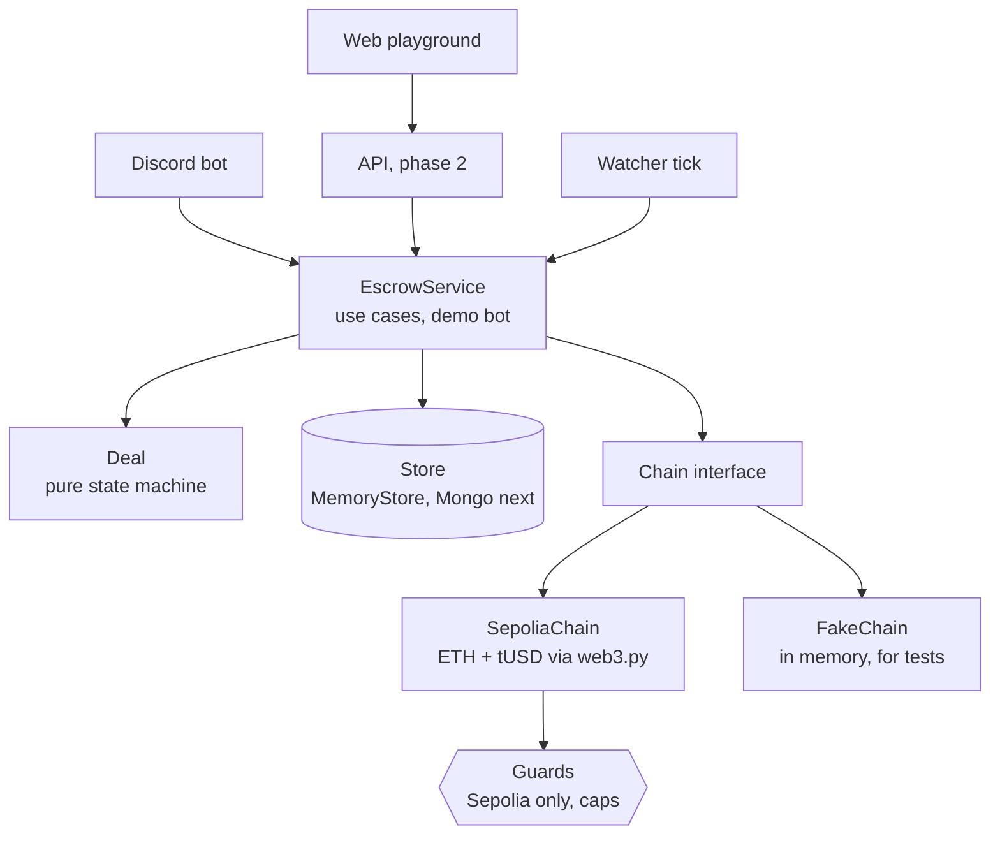

# Holdfast

> **Test networks only.** Holdfast runs on Ethereum's Sepolia test network. Test tokens have no value.
> Never send real funds. This is a portfolio demo, not a service.

Holdfast is a crypto escrow engine. Two strangers agree on a trade; the buyer pays a deposit address
that belongs to that deal alone; Holdfast watches the chain until the payment is confirmed, then sends
the money to the seller when the buyer confirms delivery, or back to the buyer on a refund. Disputes
go to an arbiter, or settle on a timer by a written rule.

It's a clean-room public version of the core of an escrow system I run privately, which has secured
over $1M for more than 10,000 users. That code stays private; this one is written from scratch to show
how the engine works, with the parts that make it a business (mainnet networks, fees, payouts, fraud
rules) deliberately left out.

## Try it

A web playground is coming: a chat you click through, with the demo bot as the other side of the trade
and every step a real Sepolia transaction you can open on Etherscan. Then a Discord bot on the same engine.

## How it works



- **`deal.py`** is the deal as a state machine with no I/O: thirteen states, a transition table that says
  which roles may take which actions in which states, deadlines, partial and extra payments, disputes with
  a timer, and an event log. Every refusal is a clear error.
- **`service.py`** is what the API and the Discord bot call. It loads a deal, applies one action as the
  caller's role in it, and saves it with optimistic locking. Money only moves in `settle`, which writes
  down that a payout started before sending anything.
- **`chains/`** hides the network behind one `Chain` interface. Every deal's deposit address is derived
  from one seed (BIP-44, address index = deal number), so there are no key files.
- **`guards.py`** keeps it on Sepolia (the network is checked at startup and before every send) and caps
  each deal and each day's sending.
- **`contracts/TestUSD.sol`** is the demo's dollar: 6 decimals like USDC, a daily faucet, capped minting
  for the demo bot, and a constructor that refuses any network but Sepolia or a local chain.

More in [docs/architecture.md](docs/architecture.md) and [docs/threat-model.md](docs/threat-model.md).

## Run the tests

```bash
python3.12 -m venv .venv && source .venv/bin/activate
pip install -e ".[dev]"
python scripts/compile_contract.py   # downloads solc 0.8.24 once
pytest --cov                          # state machine, service, and a real EVM (py-evm) with tUSD deployed
ruff check . && pyright
python scripts/check_mainnet.py       # fails if any mainnet RPC or chain id 1 appears in the repo
```

The Sepolia adapter is tested against an in-process EVM set to Sepolia's chain id, with tUSD compiled and
deployed, so payments, confirmations, gas top-ups, and sends are all exercised without the internet.

## Roadmap

1. **Engine** (this): state machine, service, Sepolia adapter, tUSD, tests, CI. Done.
2. **API and storage**: MongoDB store, a small HTTP API, tUSD deployed to Sepolia, the watcher as a worker.
3. **Web playground**: a Discord-style chat on [danibapsilva.github.io](https://danibapsilva.github.io)
   that walks through a trade with the demo bot.
4. **Discord bot**: the same engine in a demo server.

## License

[PolyForm Noncommercial 1.0.0](LICENSE). You may read, run, and learn from this code for any
noncommercial purpose. You may not use it, or any part of it, to make money, including running it as an
escrow service for others.
