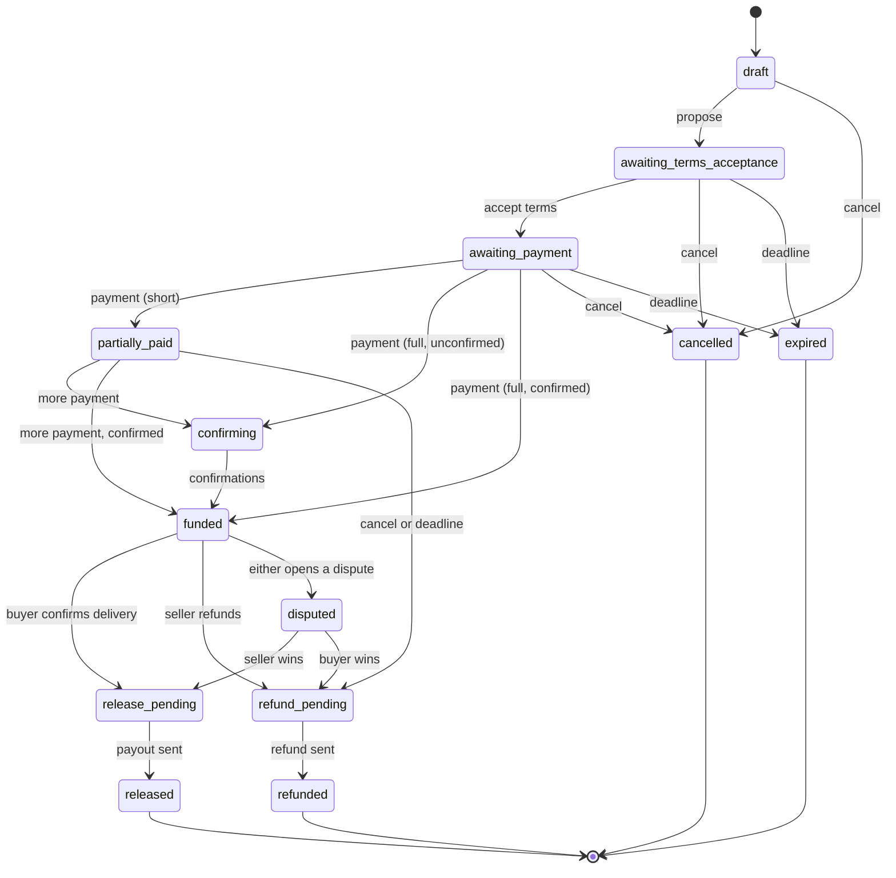

# Architecture

Holdfast is three layers: a pure state machine, a service that applies it to stored deals, and chain
adapters that talk to a network. Front ends (the web playground, the Discord bot) only ever call the
service.

## The deal state machine

`deal.py` holds this as data: `TRANSITIONS` maps every action to the states it may happen in and the
roles that may take it (buyer, seller, the system's watcher and timers, an arbiter). A method checks
the table, changes the state, and appends an event. Nothing in it reads a clock or touches a network:
`now` is passed in, so every path is tested by setting times by hand.

Rules worth knowing:

- **Money is integers.** Every amount is in the token's smallest unit. Text from a person is parsed once
  with `Decimal` and refused if it's more precise than the token allows.
- **Payments are idempotent.** A transfer is identified by transaction hash and log index. Seeing it again
  only updates its confirmations, which never go down. A transfer whose amount changes is an error.
- **Partial and extra payments.** Short of the amount, the deal is `partially_paid`; at its deadline that
  money is refunded. More than the amount still funds the deal, and the excess goes back to the buyer when
  it settles.
- **Late payments** (after the deal stopped taking them) are kept apart and flag the deal for a person.
- **Disputes.** Either side can open one once the deal is funded. An arbiter can settle it, or the timer
  does: if the other side never answered, the side that opened it wins; if both sides engaged, the buyer
  is refunded, since returning money to whoever paid it can't strand anyone's funds.
- **Payouts start once.** `begin_payout` is saved before any transfer is sent; it can't be started twice.

## The service

`EscrowService` is the API and the Discord bot's only entry point. Each call loads a deal, works out the
caller's role in it (or refuses), applies one action, and saves with optimistic locking: the store refuses
a save if the deal changed since it was loaded.

- `tick()` is the background worker: it credits new payments, runs deadlines and dispute timers, and sends
  settlements that are ready. It's safe to run often and from a restart.
- `settle()` sends what a release or refund owes, once the needed addresses are known. It checks the
  daily cap, saves `payout_started`, sends, and marks the deal settled. If a send fails partway, the deal
  is flagged for a person and never retried blindly.
- The demo bot (`DEMO_USER`) can be the other side of a deal: it accepts at once, pays when it's the buyer
  (minting tUSD to the deposit address), releases when the seller says they've delivered, and receives the
  payout at its own address when it's the seller. `demo_pay` is the web playground's Pay button.

## Chains

`Chain` is a protocol: derive a deposit address, list payments to an address with confirmations, send,
fund the demo, and link to an explorer. Two implementations:

- `SepoliaChain` (web3.py). tUSD payments come from the token's `Transfer` logs filtered to the deposit
  address. Native ETH payments come from scanning recent blocks, which is slower, so the demo uses tUSD.
  Before a deposit address sends tUSD, the treasury tops it up with just enough ETH for gas.
- `FakeChain` keeps balances and transfers in memory, and blocks only advance when a test says so.

Keys: one BIP-39 seed in `HOLDFAST_SEED`. Deal *n* pays into `m/44'/60'/0'/0/n`; the treasury (gas,
minting, the demo bot) is `m/44'/60'/1'/0/0`. No key ever touches the disk.

## Storage

`Store` is an interface with an in-memory implementation today. The Mongo version (phase 2) is specified
in `store.py`: deals keyed by id with a version for optimistic locking, and a `transfers` collection whose
unique `_id` is the double-credit guard. It uses PyMongo rather than Motor: Motor is deprecated in favor
of PyMongo's own async API, and one dependency serves both the worker and an async web API.

## Testing

- The state machine test walks every action against every state and role in the transition table, then
  exercises each path, deadline, and rule.
- The service tests run whole trades on `FakeChain`: releases, refunds, partial payments, expiry,
  overpayment, disputes, the demo bot, double-credit, a failing send, caps, and concurrent writers.
- The Sepolia tests run against py-evm in-process, with the chain id set to Sepolia's and tUSD compiled
  and deployed: payment detection, confirmations, gas top-ups, sends, minting caps, the faucet, and a
  whole demo deal.

## Errors

Every deliberate error descends from `HoldfastError` (`errors.py`): deal rules (`DealError`), the network
(`ChainError`), the guards (`GuardError`), storage conflicts (`Conflict`), settings (`ConfigError`), amounts
(`AmountError`), and the seed (`SeedError`). Each message is written to be shown to the person who acted, so
the API maps the family to a 4xx response and anything else to a logged 500.
